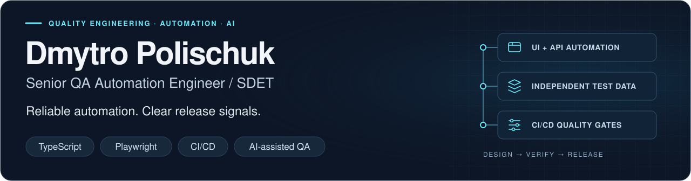

<picture>
  <source media="(max-width: 600px)" srcset="assets/header-mobile.svg">
  
</picture>

**Calgary, Canada** &nbsp; · &nbsp; [LinkedIn](https://www.linkedin.com/in/dmytro-polischuk/) &nbsp; · &nbsp; [Email](mailto:polischuk.dm23@gmail.com)

**Building reliable test automation, maintainable frameworks, and quality gates that catch defects before release.**

## About Me

I'm a Senior QA Automation Engineer / SDET with experience in banking, financial services, and cybersecurity. I build UI, API, integration, and end-to-end automation, from the framework architecture to the checks that run in CI.

My focus is practical: independent test data, repeatable execution, and failures that tell an engineer what to investigate. I work alongside developers to make quality checks part of everyday delivery.

## Technical Expertise

| Focus            | Tools and practices                                                           |
| :--------------- | :---------------------------------------------------------------------------- |
| **Languages**    | TypeScript, JavaScript, Java                                                  |
| **Automation**   | Playwright, Cypress, UI / API / integration / E2E testing                     |
| **API & data**   | REST Assured, JUnit, SQL, PostgreSQL                                          |
| **Architecture** | Test framework design, test isolation, reusable fixtures, test data strategy  |
| **Delivery**     | GitHub Actions, CI/CD integration, parallel execution, quality gates          |
| **AI workflows** | AI-assisted development and QA, with human review and executable verification |

## Featured Projects

### [SDET Automation Patterns Lab](https://github.com/Kunonuk/sdet-automation-patterns-lab)

A TypeScript automation lab with Playwright UI/API smoke tests, validated environment configuration, and a deterministic local quality gate.

**Stack:** TypeScript · Playwright · Jest · Allure

**Engineering focus:** Separating deterministic checks from live-system smoke tests, avoiding hardcoded catalogue IDs, and producing useful failure reports. The current foundation is implemented; the broader pattern catalogue and CI integration are on the roadmap.

### [Chess Combinations Trainer](https://github.com/Kunonuk/chess-combinations-trainer)

A browser-based chess tactics trainer with legal-move validation, solution playback, saved study progress, and keyboard-accessible interactions.

**Stack:** TypeScript · React · chess.js · Vitest · Playwright · GitHub Actions

**Engineering focus:** Testing domain rules and persistence alongside desktop/mobile user journeys, with build, lint, unit, and headless browser checks in CI.

[Try the live trainer →](https://kunonuk.github.io/chess-combinations-trainer/)

## Engineering Highlights

- **Faster regression feedback:** Reduced a regression cycle from **6 hours to 1 hour** through parallel execution, independent test data, and CI/CD pipeline redesign.
- **Automation at scale:** Built a test framework with **500+ automated UI, API, and E2E tests** for an international payments platform.
- **Quality built into delivery:** Established Cypress integration tests from scratch and integrated them into CI/CD as the first QA engineer on a team.

## Connect

For Senior SDET / QA Automation opportunities or a conversation about test architecture:

[LinkedIn](https://www.linkedin.com/in/dmytro-polischuk/) &nbsp; · &nbsp; [GitHub](https://github.com/Kunonuk) &nbsp; · &nbsp; [polischuk.dm23@gmail.com](mailto:polischuk.dm23@gmail.com)
