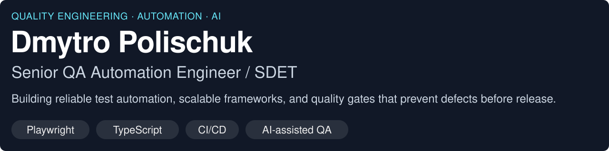

<picture>
  <source media="(max-width: 767px)" srcset="assets/intro-mobile.svg">
  
</picture>

<strong>Calgary, Canada</strong> · Banking · Financial services · Cybersecurity

  
  

## 🤖 AI-Driven Quality Engineering

I use **Claude Code** and AI agents daily for test development, framework refactoring, technical analysis, and debugging.

- **PR review:** Integrated **GitHub Actions**, **Claude Code**, and **Jira MCP** to analyze changes against Jira acceptance criteria, identify coverage gaps, and recommend test scenarios.
- **MCP and agents:** Integrate workflows into development and QA processes.

## 🏅 Engineering Achievements

| Impact                                       | Engineering contribution                                                                                                |
| :------------------------------------------- | :---------------------------------------------------------------------------------------------------------------------- |
| **6 hours → 1 hour** Regression execution | Parallel execution, isolated test data, and redesigned GitLab CI/CD pipelines.                                          |
| **64% fewer** critical defects               | Reduced newly reported critical defects on the `master` branch through QA process and automation strategy improvements. |
| **≈1,000 tests** migrated                    | Cypress → Playwright migration with TypeScript Page Objects, seeded test data, and GitHub Actions.                      |

**CI quality gates:** Added flaky-test checks for new and modified tests, results in pull requests, and merge blocking on failed checks.

## 🛠️ Tech Stack

**Languages**

  
  
  

**UI & E2E Automation**

  
  
  

**API Testing & Test Runners**

  
  
  
  

**CI/CD & Infrastructure**

  
  
  
  

**Data & Diagnostics**

  
  
  

## 🧰 Featured Projects

| Project                                                                                     | What you'll find                                                                                                                                                                                                                                  |
| :------------------------------------------------------------------------------------------ | :------------------------------------------------------------------------------------------------------------------------------------------------------------------------------------------------------------------------------------------------ |
| **[SDET Automation Patterns Lab](https://github.com/Kunonuk/sdet-automation-patterns-lab)** | Automation foundation with UI/API smoke tests, config unit tests, and HTML and Allure reports.  TypeScript · Playwright · Jest · Allure                                                                                                     |
| **[Chess Combinations Trainer](https://github.com/Kunonuk/chess-combinations-trainer)**     | A chess tactics app with legal-move and study-pack validation, saved progress, and desktop and mobile tests in CI.  React · TypeScript · Vitest · Playwright · **[Play the demo ↗](https://kunonuk.github.io/chess-combinations-trainer/)** |

## 💼 Where I've Worked

- <samp><strong>CirrusLabs</strong> — Senior QA Automation Engineer — Feb 2024–Present</samp>
- <samp><strong>Raiffeisen Bank</strong> — Senior QA Automation Engineer — Apr 2022–Feb 2024</samp>
- <samp><strong>Orbit Group</strong> — QA Automation Engineer — Jul 2021–Apr 2022</samp>
- <samp><strong>Innovative People</strong> — QA Automation Engineer — Aug 2020–Jul 2021</samp>
- <samp><strong>Reliability Technology</strong> — QA Automation Engineer — May 2019–Aug 2020</samp>
- <samp><strong>Institute for System Automation of Processes</strong> — QA Engineer — Jun 2018–May 2019</samp>

## 🤝 Let's Connect

Discuss test architecture, AI engineering workflows, and reliable delivery.

  
  

<a href="https://github.com/Kunonuk">github.com/Kunonuk</a> · <a href="mailto:polischuk.dm23@gmail.com">polischuk.dm23@gmail.com</a>

